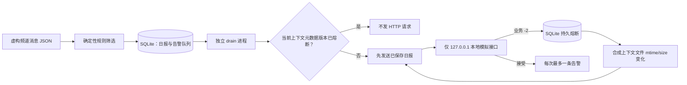

# Telegram AI Monitor Demo

**一个面向可靠性问题的离线 Python 演示：模拟 Telegram 消息筛选、SQLite 持久队列、微信 `-2` 熔断，以及有序恢复。**

这是一个真实个人自动化项目的脱敏作品集演示。它不连接 Telegram、微信、OpenClaw 或模型服务；所有频道、消息、日报和接口响应都是虚构数据。招聘者可在本机运行完整流程，观察故障前后的 SQLite 状态。

## 项目解决的问题

原自动化流程需要把公开 Telegram 频道中的有用信息筛选后，整理成日报或实时告警并交付到微信。一次真实故障暴露出下行接口持续返回业务错误 `-2` 时，盲目重试可能形成发送循环；恢复时还要保留已有日报和积压告警，并控制补发速度。

本 Demo 把这个可靠性场景缩小成离线、可重复的故障演练。原系统背景、历史证据和个人贡献边界见[项目案例](docs/case-study.md)。

## 技术栈

- 原系统：Python、Telethon、SQLite、PowerShell / Windows Task Scheduler、微信本地接口及配置的模型服务。
- 本 Demo：Python 3.11+、标准库 `sqlite3`、`http.server`、`unittest` 和多个独立子进程；无第三方依赖。
- 消息规则是确定性的模拟筛选逻辑（主题词 + 发布标记，先排除推广），**不代表已接入模型或在线 Agent**。

## 架构与运行流程



`demo` 按阶段启动独立 Python 进程。它显示筛选结果和各阶段 SQLite 摘要；同一文件版本跨进程仍被阻断，版本变化后复用数据库里的原日报，再以可注入的模拟时钟逐条恢复告警。

## 关键工程设计

1. **让故障状态跨重启存活：** 把 `-2` 与当前文件的 `mtime_ns:size` 版本写入 SQLite；检查时只调用 `stat()`，不读取文件内容。相同版本不产生第二个 HTTP 请求。
2. **把恢复做成有序状态迁移：** 数据库中保存的 `send_failed` 日报优先补发，不重新生成、不调用模型；日报成功后才轮到告警。
3. **把限速放在共享状态边界：** SQLite `BEGIN IMMEDIATE` 事务持久化告警发送尝试时间，独立进程共享每 60 秒最多一次的限制；另有发送租约防止并发重复处理日报。
4. **收紧演示出口：** 客户端只接受精确的 `http://127.0.0.1:<port>/mock/weixin/send`；请求没有认证、Cookie 或凭据字段，假接口也只绑定回环地址。
5. **让验收可复现：** 合成时间验证 59 秒阻断和 60 秒放行；多进程测试覆盖熔断、恢复和并发，不依赖真实账号或等待一分钟。

## 演示

当前交付提供[终端演示录制方案与讲解脚本](docs/demo-recording.md)。本环境未生成伪造的运行截图或 GIF；请按脚本在干净终端运行 Demo 后录制真实画面。命令会在退出时清理临时 SQLite 数据库和合成上下文文件。

## 本地运行

需要 Python 3.11 或更高版本：

```powershell
python -m telegram_ai_monitor_demo demo
python -m unittest discover -s tests -v
```

可检查独立演示数据库的摘要：

```powershell
python -m telegram_ai_monitor_demo status --db .demo-state/demo.sqlite3
```

`demo` 使用系统临时目录并在结束后清理。手动运行 `collect` / `drain` 时，请仅使用合成 fixture 和本项目本地假接口。

## 测试与 CI

`unittest` 在临时目录中启动多个 Python 子进程和本地 HTTP 假接口，验证：合成筛选与去重、`-2` 后 SQLite 熔断、同版本跨进程零请求、变更版本后日报原文优先复用、59/60 秒限速、并发发送互斥、本地端点拒绝，以及临时目录清理。Python 3.11 和 3.12 的实际命令回执见[验收记录](docs/verification.md)。GitHub Actions 对 Python 3.11 和 3.12 运行同一测试和编译检查，不需要 secrets。

公开文件通过 `PUBLIC_ALLOWLIST.txt` 明确列举，并由 `scripts/check_public_tree.py` 检查未列入白名单的文件和常见凭据模式。

## 个人职责与 AI 辅助

我负责真实项目的需求拆解、采集与运行边界、`-2` 故障处理目标、持久熔断条件、恢复顺序、告警节奏、数据保护要求以及验收决策。原项目由 AI Coding Agent 辅助部分实现；本仓库的离线 Demo、测试和文档也是 AI 辅助搭建的，不宣称 Demo 代码全部由我独立手写。详细职责拆分与历史证据见[项目案例](docs/case-study.md)。

## 公开 Demo 与原系统的区别

| 项目 | 原个人自动化系统 | 本公开 Demo |
|---|---|---|
| 输入 | 经配置的公开频道 | 虚构 JSON fixture |
| 规则判断 | 规则与历史配置的模型复核流程 | 固定 Python 规则，无模型调用 |
| 状态 | 原运行环境中的 SQLite / 任务状态 | 临时目录中的演示 SQLite |
| 发送 | 原环境中的微信下行链路 | 仅回环地址的模拟接口 |
| 凭据与数据 | 属于原运行环境 | 不复制、不读取、不引用 |

历史运行回执只在案例文档中按日期和范围说明，不是本 Demo 的新测试结果，也不等于人工确认收件。

## 已知局限与后续方向

- Demo 通过本地假接口展示控制流，不验证真实微信服务的可用性、授权或送达。
- 文件元数据版本是可靠性门槛演示，不是生产身份认证或密码学会话校验。
- 模拟时钟用于快速验证节流边界；真实运行时限速依赖系统时间。
- 当前筛选规则是小型确定性样例，不评估在线模型质量、队列吞吐或长期成功率。
- 后续可增加状态迁移图、失败注入矩阵和更细粒度的送达确认接口测试，但应继续维持生产数据与公开 Demo 隔离。

## 公开边界

本公开 Demo 仓库仅包含白名单列出的源码、合成 fixture、文档、测试和 CI 配置。它与原个人自动化系统分离，不包含原系统源码副本、真实运行数据或服务凭据。
